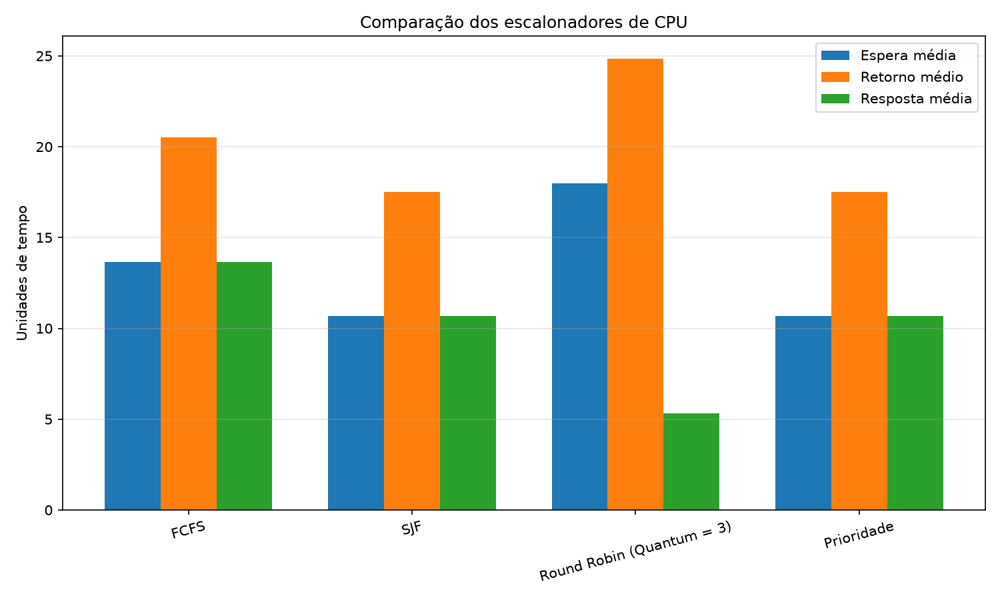
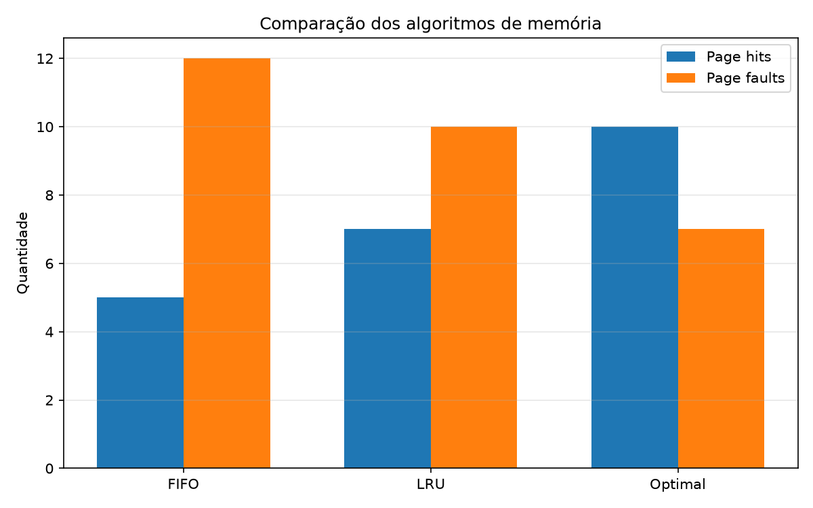

# KernelLab — Simulador de Sistemas Operacionais

# Sobre o projeto

O KernelLab é um simulador desenvolvido em Python para demonstrar conceitos fundamentais de Sistemas Operacionais. O projeto permite estudar o escalonamento de processos, o gerenciamento de memória virtual e o controle de acesso a dispositivos.

# Funcionalidades

# 1. Escalonamento de CPU
- FCFS (First Come, First Served)
- SJF (Shortest Job First)
- Round Robin, com quantum configurável
- Escalonamento por prioridade
- Gráfico e cálculo de métricas dos processos
- Tempo de espera, retorno e resposta
- Contagem de trocas de contexto

# 2. Gerenciamento de memória
- Algoritmos FIFO, LRU e Optimal
- Simulação de substituição de páginas
- Visualização do estado dos quadros de memória
- Contagem de acertos e faltas de página
- Comparação entre algoritmos

# 3. Controle de dispositivos
- Simulação de acesso a disco, rede, áudio e logs
- Matriz de permissões por processo
- Filas de solicitações
- Uso de mecanismos de exclusão mútua

# Tecnologias utilizadas

- Python
- Matplotlib
- JSON
- `threading` e `collections`

# Como executar

1. Instale o Python 3.
2. Abra o terminal na pasta principal do projeto.
3. Instale a dependência:

   ```bash
   python -m pip install -r requirements.txt
   ```

4. Execute o simulador:

   ```bash
   python src/main.py
   ```

# Como executar os testes

Execute no terminal:

```bash
python -m unittest discover -s tests -p "test_*.py" -v
```

# Estrutura do projeto

- `src/`: código-fonte do simulador.
- `data/`: dados dos processos.
- `tests/`: testes automatizados.
- `resultados/`: gráficos gerados pelo programa.
- `docs/`: documentação e materiais do projeto.

# Objetivo acadêmico

Demonstrar, por meio de simulações, o funcionamento de algoritmos e mecanismos utilizados em Sistemas Operacionais, permitindo comparar resultados e discutir desempenho, justiça no escalonamento e gerenciamento de recursos.

# Observação

O KernelLab é um projeto acadêmico de simulação. Os resultados representam o comportamento dos algoritmos implementados, não o funcionamento interno de um sistema operacional real.
## Resultados

O KernelLab permite comparar os algoritmos de escalonamento de CPU e de substituição de páginas de memória utilizando cenários de entrada definidos no projeto.

Nos testes realizados, foram observados os seguintes resultados:

# Escalonamento de CPU

| Algoritmo | Tempo médio de espera | Tempo médio de retorno | Tempo médio de resposta | Trocas de contexto |
|---|---:|---:|---:|---:|
| FCFS | 13,67 | 20,50 | 13,67 | 5 |
| SJF | 10,67 | 17,50 | 10,67 | 5 |
| Round Robin (quantum 3) | 18,00 | 24,83 | 5,33 | 13 |
| Prioridade | 10,67 | 17,50 | 10,67 | 5 |

# Gerenciamento de memória

| Algoritmo | Acertos | Falhas de página |
|---|---:|---:|
| FIFO | 5 | 12 |
| LRU | 7 | 10 |
| Optimal | 10 | 7 |

Os resultados são específicos para as entradas utilizadas. Alterações nos processos, na sequência de referências de memória ou nos parâmetros podem produzir resultados diferentes.

# Gráficos

**Comparação dos algoritmos de CPU**



**Comparação dos algoritmos de memória**



# Limitações e melhorias futuras

O projeto tem finalidade acadêmica e representa conceitos de Sistemas Operacionais por meio de simulações. Entre as possíveis melhorias estão a inclusão de novos algoritmos, a configuração interativa dos cenários, o aprofundamento da simulação de concorrência e a ampliação dos testes automatizados.